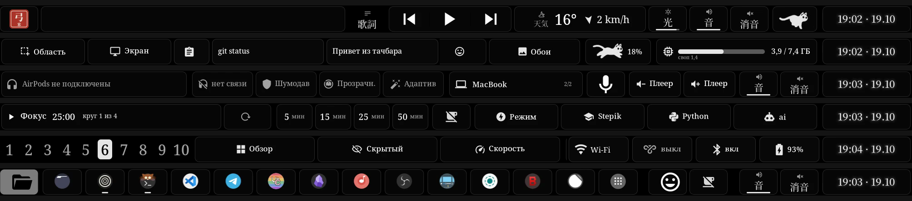
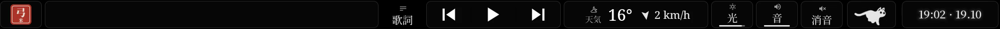
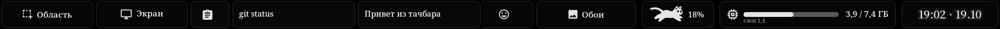
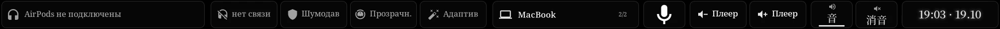
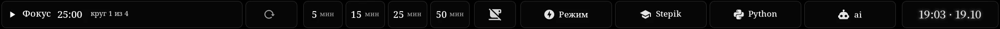
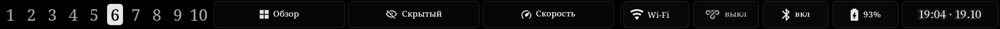

# 🎛️ yumi-touchbar

<p>
  
  
  
  
  
</p>

**🇬🇧 [English](#en)** · **🇮🇹 [Italiano](#it)** · **🇺🇦 [Українська](#uk)** · **🇷🇺 [Русский](#ru)**

<p align="center"></p>

<sub>Frames recorded from the real Touch Bar (`touchbar-agent record`): Main · Tools · Sound & AirPods · Focus ·
Windows & network · Folder.</sub>

---

<a name="en"></a>

## 🇬🇧 English

My Touch Bar on Linux: [touchbard](https://github.com/0800tim/touchbard) with **swipe between layers**
(also with two fingers, from anywhere), 15 plugins - AirPods, Pomodoro, RAM, clipboard, a dock with real app
icons, sound output, a running cat - in an "ink" style: serif type, Japanese captions, outline buttons and a red
seal. Colours follow the wallpaper. Part of my desktop [yumi-rice](https://github.com/sonoyumi/yumi-rice).

### What it does

- **5 layers on a long swipe:** Main · Tools · Sound & AirPods · Focus · Windows & network.
  A swipe of about 4.5 cm switches the layer; the neighbour slides in with its name.
  **Two fingers** swipe from anywhere, even from a slider or ⏯. With yumi-rice, Ctrl+Super+1…7 opens a layer by number.
- **Folder** (the seal on the left): a dock with colour app icons from your icon theme and a mark under running apps.
- **App layers:** the focused window gets its own buttons - Telegram, Zen, Dolphin, VS Code, Obsidian, Discord,
  kitty. 󰕮 on the left goes back to Main.
- **Plugins:** AirPods battery and listening mode, sound output switcher, player volume, RAM, clipboard history,
  Pomodoro + quick timers, Wi-Fi / VPN / Bluetooth / battery, a clock, caffeine, a cat that runs faster when the CPU is busy.
- **Touch ID window "seal":** with [yumi-touchid](https://github.com/sonoyumi/yumi-touchid) the fingerprint prompt
  shows the seal and stays while the sensor waits.
- **Readable:** `yumi-row` draws a 24 px icon + a 16-17 px label instead of touchbard's 32 px bold text.

| Layer | |
|---|---|
| Main |  |
| Tools |  |
| Sound & AirPods |  |
| Focus |  |
| Windows & network |  |
| Folder |  |

### Installation

```zsh
git clone https://github.com/sonoyumi/yumi-touchbar.git
cd yumi-touchbar
./install.sh                 # or ./install.sh --keep-config to keep your config.toml
```

`install.sh` checks out touchbard at a pinned commit, applies [`patches/`](patches), runs the tests, builds,
runs touchbard's own installer with sudo (it rolls back to tiny-dfr if the daemon does not start), copies the
style, plugins and scripts for your user (a different existing file is kept as `*.bak-yumi-touchbar`) and starts
the session agent. Undo: `./uninstall.sh`.

Needs: a MacBook with a Touch Bar on Asahi Linux (tested on MacBook Pro 13" M1, Arch Linux ARM), `rust gcc git
python-cairo python-gobject librsvg wtype`, fonts Noto Serif, Noto Serif CJK JP and JetBrainsMono Nerd Font. Many
buttons call parts of yumi-rice (`qs -c yumi …`, `yumi-screenshot`, `yumi-launch`, the yumi-airpods service for
the AirPods cells, the wallpaper colours) - without it, change those commands in `~/.config/touchbar/config.toml`.
The "ai" button needs Ollama; to start it without a password see [`extras/50-yumi-ollama.rules`](extras/50-yumi-ollama.rules).

| Command | What it does |
|---|---|
| `yumi-touchbar-layer [N]` | Show layer N (bind it to Ctrl+Super+1…7) or list the numbers |
| `yumi-touchbar-theme` | Take the colours from the wallpaper accent of yumi-rice |
| `yumi-player-volume up\|down` | Volume of the player's own stream, not the system |
| `yumi-dolphin-go PATH` | Open a folder in the focused Dolphin window |

### What the patches change

Long and two-finger swipe, deferred key presses so a swipe never presses ⏯, the app layer in the swipe ring,
outline pills and a serif font, the Touch ID "seal" window, a frame cap, Cyrillic in the built-in font,
13 unit tests (touchbard had none). Agent: yumi-rice commands, plugins kept alive while swiping, weather at boot,
PipeWire mute resync. Details: [docs/PATCHES.md](docs/PATCHES.md).

### Project structure

```
install.sh / uninstall.sh   # touchbard at a pinned commit + patches, user files, agent
patches/                    # 0001 daemon (Rust), 0002 agent (Python)
styles/yumi.toml            # the style: 5 swipe layers, Folder, F1-F12, app layers
plugins/                    # 15 plugins + shared code (cairo); yumi-runcat2 reuses yumi-runcat
bin/                        # layer switcher, theme from the wallpaper, player volume, Dolphin
share/hanko.png             # the seal (Folder button, Touch ID window)
extras/                     # optional polkit rule for the "ai" button
docs/                       # PATCHES.md, img/
```

### Thanks

[touchbard](https://github.com/0800tim/touchbard) by 0800tim - the daemon and agent this is built on (MIT).
The running cat - frames from [RunCat365](https://github.com/Kyome22/RunCat365) by Kyome22 (Apache-2.0).
See [NOTICE](NOTICE).

### License

MIT - see [LICENSE](LICENSE).

---

<a name="it"></a>

## 🇮🇹 Italiano

La mia Touch Bar su Linux: [touchbard](https://github.com/0800tim/touchbard) con lo **swipe tra i livelli**
(anche a due dita, da qualunque punto), 15 plugin - AirPods, Pomodoro, RAM, appunti, un dock con le vere icone
delle app, uscita audio, un gatto che corre - in stile "inchiostro": caratteri con grazie, didascalie giapponesi,
pulsanti a contorno e un sigillo rosso. I colori seguono lo sfondo. Fa parte del mio desktop
[yumi-rice](https://github.com/sonoyumi/yumi-rice).

### Cosa fa

- **5 livelli con uno swipe lungo:** Principale · Strumenti · Suono e AirPods · Concentrazione · Finestre e rete.
  Uno swipe di circa 4,5 cm cambia livello; il vicino entra scorrendo con il suo nome.
  **Due dita** scorrono da qualunque punto, anche da uno slider o da ⏯. Con yumi-rice, Ctrl+Super+1…7 apre un livello per numero.
- **Cartella** (il sigillo a sinistra): un dock con le icone a colori del tema e un segno sotto le app aperte.
- **Livelli delle app:** la finestra in primo piano ha i suoi pulsanti - Telegram, Zen, Dolphin, VS Code,
  Obsidian, Discord, kitty. 󰕮 a sinistra torna al livello principale.
- **Plugin:** batteria e modalità di ascolto degli AirPods, scelta dell'uscita audio, volume del player, RAM,
  cronologia degli appunti, Pomodoro + timer rapidi, Wi-Fi / VPN / Bluetooth / batteria, orologio, caffeina,
  un gatto che corre più veloce quando la CPU lavora.
- **Finestra Touch ID "sigillo":** con [yumi-touchid](https://github.com/sonoyumi/yumi-touchid) la richiesta
  dell'impronta mostra il sigillo e resta finché il sensore aspetta.

Le immagini dei livelli sono nella [sezione inglese](#en).

### Installazione

```zsh
git clone https://github.com/sonoyumi/yumi-touchbar.git
cd yumi-touchbar
./install.sh                 # oppure ./install.sh --keep-config per tenere il tuo config.toml
```

`install.sh` prende touchbard a un commit fisso, applica [`patches/`](patches), esegue i test, compila, avvia
l'installer di touchbard con sudo (se il demone non parte torna a tiny-dfr), copia stile, plugin e script per il
tuo utente (un file diverso già presente resta come `*.bak-yumi-touchbar`) e avvia l'agente di sessione.
Per annullare: `./uninstall.sh`.

Serve: un MacBook con Touch Bar su Asahi Linux (provato su MacBook Pro 13" M1, Arch Linux ARM), `rust gcc git
python-cairo python-gobject librsvg wtype`, i font Noto Serif, Noto Serif CJK JP e JetBrainsMono Nerd Font. Molti
pulsanti usano parti di yumi-rice (`qs -c yumi …`, `yumi-screenshot`, `yumi-launch`, il servizio yumi-airpods,
i colori dello sfondo) - senza, cambia quei comandi in `~/.config/touchbar/config.toml`. Il pulsante "ai" richiede
Ollama; per avviarlo senza password vedi [`extras/50-yumi-ollama.rules`](extras/50-yumi-ollama.rules).

| Comando | Cosa fa |
|---|---|
| `yumi-touchbar-layer [N]` | Mostra il livello N (da legare a Ctrl+Super+1…7) o elenca i numeri |
| `yumi-touchbar-theme` | Prende i colori dall'accento dello sfondo di yumi-rice |
| `yumi-player-volume up\|down` | Volume del flusso del player, non del sistema |
| `yumi-dolphin-go PERCORSO` | Apre una cartella nella finestra di Dolphin in primo piano |

### Cosa cambiano le patch

Swipe lungo e a due dita, tasti premuti in ritardo così uno swipe non preme mai ⏯, il livello dell'app
nell'anello dello swipe, pulsanti a contorno e font con grazie, la finestra Touch ID "sigillo", limite di
fotogrammi, cirillico nel font integrato, 13 test (touchbard non ne aveva). Agente: comandi di yumi-rice, plugin
tenuti vivi durante lo swipe, meteo all'avvio, risincronizzazione del muto con PipeWire.
Dettagli: [docs/PATCHES.md](docs/PATCHES.md).

### Ringraziamenti

[touchbard](https://github.com/0800tim/touchbard) di 0800tim - demone e agente su cui si basa (MIT).
Il gatto - fotogrammi da [RunCat365](https://github.com/Kyome22/RunCat365) di Kyome22 (Apache-2.0).
Vedi [NOTICE](NOTICE).

### Licenza

MIT - vedi [LICENSE](LICENSE).

---

<a name="uk"></a>

## 🇺🇦 Українська

Мій Touch Bar на Linux: [touchbard](https://github.com/0800tim/touchbard) зі **свайпом між шарами**
(також двома пальцями, з будь-якого місця), 15 плагінів - AirPods, Pomodoro, пам'ять, буфер обміну, док зі
справжніми значками програм, вихід звуку, кіт, що біжить, - у стилі «туш»: шрифт із зарубками, японські підписи,
кнопки-рамки й червона печатка. Кольори - з шпалер. Частина мого робочого столу
[yumi-rice](https://github.com/sonoyumi/yumi-rice).

### Що вміє

- **5 шарів довгим свайпом:** Головний · Інструменти · Звук і AirPods · Фокус · Вікна й мережа.
  Свайп приблизно на 4,5 см перемикає шар; сусідній виїжджає зі своєю назвою.
  **Двома пальцями** - з будь-якого місця, навіть із повзунка чи ⏯. З yumi-rice Ctrl+Super+1…7 - шар за номером.
- **Папка** (печатка ліворуч): док із кольоровими значками з теми й позначкою під запущеними програмами.
- **Шари програм:** вікно у фокусі отримує свої кнопки - Telegram, Zen, Dolphin, VS Code, Obsidian, Discord,
  kitty. 󰕮 ліворуч повертає на Головний.
- **Плагіни:** заряд і режим AirPods, вибір виходу звуку, гучність плеєра, пам'ять, історія буфера,
  Pomodoro + швидкі таймери, Wi-Fi / VPN / Bluetooth / батарея, годинник, «кава», кіт, що біжить швидше під навантаженням.
- **Вікно Touch ID «печатка»:** з [yumi-touchid](https://github.com/sonoyumi/yumi-touchid) запит відбитка
  показує печатку й тримається, поки сенсор чекає.

Картинки шарів - в [англійському розділі](#en).

### Встановлення

```zsh
git clone https://github.com/sonoyumi/yumi-touchbar.git
cd yumi-touchbar
./install.sh                 # або ./install.sh --keep-config, щоб лишити свій config.toml
```

`install.sh` бере touchbard на зафіксованому коміті, накладає [`patches/`](patches), запускає тести, збирає,
запускає власний інсталятор touchbard через sudo (якщо демон не стартував - повертає tiny-dfr), копіює стиль,
плагіни й скрипти для вашого користувача (інший наявний файл лишається як `*.bak-yumi-touchbar`) і вмикає
агент сеансу. Відкат: `./uninstall.sh`.

Потрібно: MacBook із Touch Bar на Asahi Linux (перевірено на MacBook Pro 13" M1, Arch Linux ARM), `rust gcc git
python-cairo python-gobject librsvg wtype`, шрифти Noto Serif, Noto Serif CJK JP і JetBrainsMono Nerd Font. Багато
кнопок викликають частини yumi-rice (`qs -c yumi …`, `yumi-screenshot`, `yumi-launch`, служба yumi-airpods,
кольори шпалер) - без нього змініть ці команди в `~/.config/touchbar/config.toml`. Кнопці «ai» потрібна Ollama;
щоб запускати її без пароля - [`extras/50-yumi-ollama.rules`](extras/50-yumi-ollama.rules).

| Команда | Що робить |
|---|---|
| `yumi-touchbar-layer [N]` | Показати шар N (на Ctrl+Super+1…7) або список номерів |
| `yumi-touchbar-theme` | Кольори з акценту шпалер yumi-rice |
| `yumi-player-volume up\|down` | Гучність потоку плеєра, а не системи |
| `yumi-dolphin-go ШЛЯХ` | Відкрити теку у вікні Dolphin у фокусі |

### Що змінюють патчі

Довгий свайп і свайп двома пальцями, відкладені натискання (свайп ніколи не тисне ⏯), шар програми в кільці
свайпу, кнопки-рамки й шрифт із зарубками, вікно Touch ID «печатка», обмеження кадрів, кирилиця у вбудованому
шрифті, 13 тестів (у touchbard їх не було). Агент: команди yumi-rice, плагіни живуть під час свайпу, погода
одразу після завантаження, звірка «без звуку» з PipeWire. Подробиці: [docs/PATCHES.md](docs/PATCHES.md).

### Подяки

[touchbard](https://github.com/0800tim/touchbard) від 0800tim - демон і агент, на яких це зроблено (MIT).
Кіт - кадри з [RunCat365](https://github.com/Kyome22/RunCat365) від Kyome22 (Apache-2.0). Див. [NOTICE](NOTICE).

### Ліцензія

MIT - див. [LICENSE](LICENSE).

---

<a name="ru"></a>

## 🇷🇺 Русский

Мой Touch Bar на Linux: [touchbard](https://github.com/0800tim/touchbard) со **свайпом между слоями**
(и двумя пальцами, откуда угодно), 15 плагинов - AirPods, Pomodoro, память, буфер обмена, док с настоящими
значками программ, выход звука, бегущий кот - в стиле «тушь»: шрифт с засечками, японские подписи, кнопки-рамки
и красная печать. Цвета - из обоев. Часть моего рабочего стола [yumi-rice](https://github.com/sonoyumi/yumi-rice).

### Что умеет

- **5 слоёв длинным свайпом:** Главный · Инструменты · Звук и AirPods · Фокус · Окна и сеть.
  Свайп примерно на 4,5 см переключает слой; соседний выезжает со своим названием.
  **Двумя пальцами** - откуда угодно, даже с ползунка или ⏯. С yumi-rice Ctrl+Super+1…7 - слой по номеру.
- **Папка** (печать слева): док с цветными значками из темы и отметкой под запущенными программами.
- **Слои программ:** окно в фокусе получает свои кнопки - Telegram, Zen, Dolphin, VS Code, Obsidian, Discord,
  kitty. 󰕮 слева возвращает на Главный.
- **Плагины:** заряд и режим AirPods, выбор выхода звука, громкость плеера, память, история буфера,
  Pomodoro + быстрые таймеры, Wi-Fi / VPN / Bluetooth / батарея, часы, «кофе», кот, который бежит быстрее под нагрузкой.
- **Окно Touch ID «печать»:** с [yumi-touchid](https://github.com/sonoyumi/yumi-touchid) запрос отпечатка
  показывает печать и держится, пока датчик ждёт палец.

Картинки слоёв - в [английском разделе](#en).

### Установка

```zsh
git clone https://github.com/sonoyumi/yumi-touchbar.git
cd yumi-touchbar
./install.sh                 # или ./install.sh --keep-config, чтобы оставить свой config.toml
```

`install.sh` берёт touchbard на зафиксированном коммите, накладывает [`patches/`](patches), запускает тесты,
собирает, запускает собственный установщик touchbard через sudo (если демон не поднялся - возвращает tiny-dfr),
копирует стиль, плагины и скрипты для вашего пользователя (другой существующий файл остаётся как
`*.bak-yumi-touchbar`) и включает агент сеанса. Откат: `./uninstall.sh`.

Нужно: MacBook с Touch Bar на Asahi Linux (проверено на MacBook Pro 13" M1, Arch Linux ARM), `rust gcc git
python-cairo python-gobject librsvg wtype`, шрифты Noto Serif, Noto Serif CJK JP и JetBrainsMono Nerd Font. Многие
кнопки вызывают части yumi-rice (`qs -c yumi …`, `yumi-screenshot`, `yumi-launch`, служба yumi-airpods, цвета
обоев) - без него поменяйте эти команды в `~/.config/touchbar/config.toml`. Кнопке «ai» нужна Ollama; чтобы
запускать её без пароля - [`extras/50-yumi-ollama.rules`](extras/50-yumi-ollama.rules).

| Команда | Что делает |
|---|---|
| `yumi-touchbar-layer [N]` | Показать слой N (на Ctrl+Super+1…7) или список номеров |
| `yumi-touchbar-theme` | Цвета из акцента обоев yumi-rice |
| `yumi-player-volume up\|down` | Громкость потока плеера, а не системы |
| `yumi-dolphin-go ПУТЬ` | Открыть папку в окне Dolphin в фокусе |

### Что меняют патчи

Длинный свайп и свайп двумя пальцами, отложенные нажатия (свайп никогда не жмёт ⏯), слой программы в кольце
свайпа, кнопки-рамки и шрифт с засечками, окно Touch ID «печать», предел кадров, кириллица во встроенном шрифте,
13 тестов (у touchbard их не было). Агент: команды yumi-rice, плагины живут во время свайпа, погода сразу после
загрузки, сверка «без звука» с PipeWire. Подробности: [docs/PATCHES.md](docs/PATCHES.md).

### Благодарности

[touchbard](https://github.com/0800tim/touchbard) от 0800tim - демон и агент, на которых это сделано (MIT).
Кот - кадры из [RunCat365](https://github.com/Kyome22/RunCat365) от Kyome22 (Apache-2.0). См. [NOTICE](NOTICE).

### Лицензия

MIT - см. [LICENSE](LICENSE).
